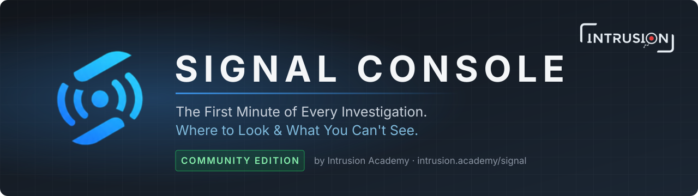
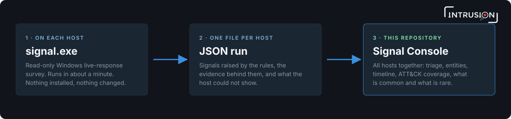
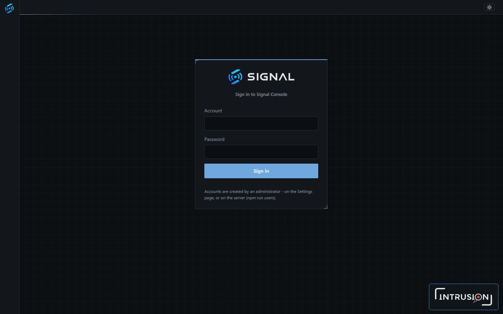
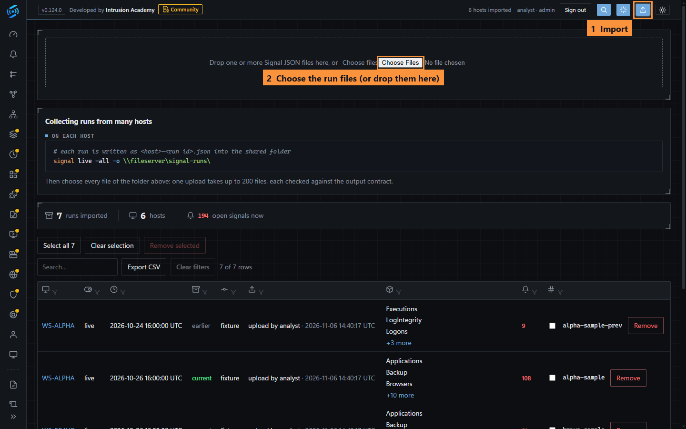
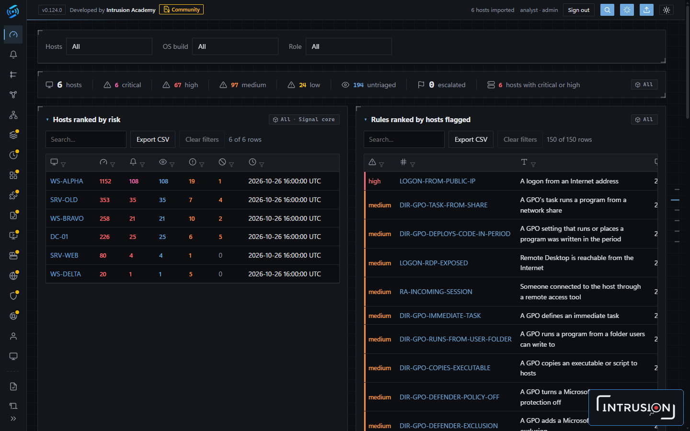
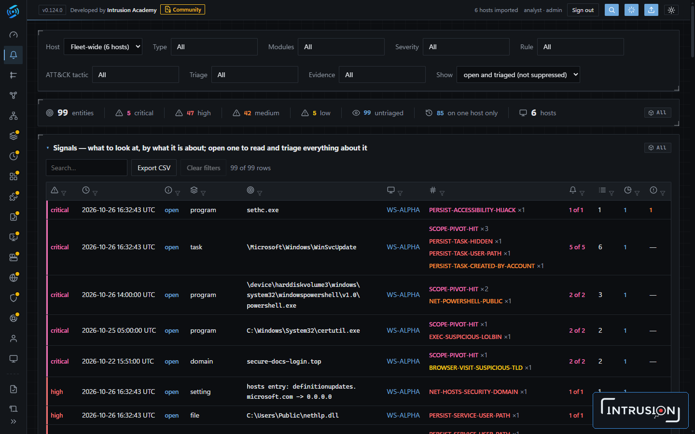

<p align="center">
  <a href="https://intrusion.academy/signal"></a>
</p>

<p align="center">
  <a href="https://intrusion.academy/signal"></a>
  <a href="https://intrusion.academy/signal/doc/latest"></a>
  <a href="#license"></a>
</p>
<p align="center">
  
  
  
  
  
  
</p>

**Signal Console** is the web console of [Signal](https://intrusion.academy/signal),
a Windows DFIR survey tool by Intrusion Academy. It imports the run files
Signal writes on each host and shows all hosts in one place.

> **Full documentation:** [intrusion.academy/signal/doc/latest](https://intrusion.academy/signal/doc/latest)<br>
> **Download Signal:** [intrusion.academy/signal](https://intrusion.academy/signal)

<br>

## Contents

1. [How it fits together](#how-it-fits-together)
2. [Features](#features)
3. [Quick start](#quick-start)
4. [Configuration](#configuration)
5. [Accounts](#accounts)
6. [Security](#security)
7. [Updating](#updating)
8. [FAQ](#faq)
9. [Getting help](#getting-help)
10. [Editions](#editions)
11. [License](#license)

<br>

## How it fits together

This repository is the console only. Signal itself is a separate executable.

<p align="center">
  
</p>

| Part | What it does | Where to get it |
|---|---|---|
| **Signal** (`signal.exe`) | Surveys a Windows host in about a minute. Read-only: installs nothing, changes nothing. Writes one JSON run file. | [intrusion.academy/signal](https://intrusion.academy/signal) |
| **Signal Console** | Imports the run files of all hosts for review and triage. | This repository |
| **Documentation** | Modules, rules, output format, deployment, console pages. | [intrusion.academy/signal/doc/latest](https://intrusion.academy/signal/doc/latest) |

<br>

## Features

| Feature | Description |
|---|---|
| Signals | What each rule raised on each host, with its evidence and the analysts' triage. |
| Evidence gaps | What each host could not provide, such as cleared or disabled logs and missing sources. |
| Entities | One page per user, process, service or file, combining every source, with its timeline and links. |
| Stacking | Programs, services, persistence and remote-access tools counted across hosts: what is common, what is rare. |
| ATT&CK coverage | The MITRE ATT&CK matrix of the rules evaluated on the hosts in view. |
| Timeline and graph | Events across hosts in UTC with analyst tags and notes, and a graph of related entities. |
| Topology | The networks the hosts are on and the connections between them. |
| Reports | A compromise assessment report from the findings and their triage. |
| Self-hosted | No cloud service, no telemetry, no build step. Local accounts, roles, audit log, HTTPS. |

<br>

## Quick start

**Requirements:** Node.js 22.5 or later, and `signal.exe`.

**Step 1. Get Signal.** Download `signal.exe` from Intrusion Academy at
[intrusion.academy/signal](https://intrusion.academy/signal). It is not
included in this repository.

**Step 2. Install and start the console.**

```bash
git clone https://github.com/intrusion-academy/Signal-Console-Community.git
cd Signal-Console-Community
npm ci --omit=dev
npm start
```

On first start, the console asks in the terminal for an administrator name
and password. It then listens on <http://localhost:7446>. Sign in with that account.

<p align="center"></p>

**Step 3. Run Signal on each host.** Write the run files to one folder, for
example a share:

```
signal live -all -o \\fileserver\signal-runs\
```

**Step 4. Import the runs.** Sign in and click the **Import** button (the upload arrow at the top right). Then click **Choose Files** and select the run files, or drag them onto the dashed box.

- Up to 200 files per upload, up to 50 MB each.
- Each file is validated before it is stored. A file from a newer Signal is refused with the reason.
- The console holds one set of runs. Remove runs on the same page.

<p align="center"></p>

**Step 5. Review.** The **Overview** ranks the hosts by risk and the rules by
the number of hosts they flagged.

<p align="center"></p>

**Signals** lists what to look at, grouped by the entity it is about. Open a
row to read and triage everything about that entity.

<p align="center"></p>

The screenshots use synthetic test data.

<br>

## Configuration

Set these environment variables before `npm start`:

| Variable | Default | Purpose |
|---|---|---|
| `PORT` | `7446` | Port the console listens on |
| `SIGNAL_CONSOLE_DATA` | `data/` | Folder for the database and imported runs |
| `SIGNAL_CONSOLE_TLS_CERT` | not set | PEM certificate (with chain) for HTTPS |
| `SIGNAL_CONSOLE_TLS_KEY` | not set | PEM private key for HTTPS |
| `SIGNAL_CONSOLE_SECURE_COOKIE` | not set | Set to `1` behind a reverse proxy that terminates HTTPS |

<br>

## Accounts

Every page and API route requires sign-in. Accounts are local; there is no
self-registration.

| Role | Permissions |
|---|---|
| `admin` | Everything, including accounts, settings and the audit log |
| `analyst` | Triage, suppression rules, flags, importing and removing runs |
| `viewer` | Read only |

Manage accounts on **Settings > Users**, or on the server:

| Command | Action |
|---|---|
| `npm run users -- add <name> <role>` | Create an account |
| `npm run users -- list` | List accounts |
| `npm run users -- passwd <name>` | Set a password |
| `npm run users -- role <name> <role>` | Change a role |
| `npm run users -- disable <name>` / `enable <name>` | Disable or enable |
| `npm run users -- remove <name>` | Delete an account |

<br>

## Security

| Area | Behaviour |
|---|---|
| Passwords | Salted scrypt hashes |
| Sessions | Random token in an HttpOnly, SameSite=Strict cookie, stored as a hash. Ends after 8 hours idle, 7 days, sign-out, or an account change. |
| Sign-in | Locked for 15 minutes after repeated failures |
| Audit | Sign-ins and account changes recorded (admins only) |
| Headers | Content-Security-Policy, no framing, `nosniff`, no referrer, HSTS over HTTPS |
| Transport | Use HTTPS beyond a single machine (see [Configuration](#configuration)) |

To report a vulnerability, see [SECURITY.md](SECURITY.md).

<br>

## Updating

Your data stays in the data folder (`data/` or `SIGNAL_CONSOLE_DATA`) and is
kept across updates. Back it up first, then:

```bash
git pull
npm ci --omit=dev
npm start
```

Changes in each release are listed in [CHANGELOG.md](CHANGELOG.md).

<br>

## FAQ

**Where do I get `signal.exe`?**
From Intrusion Academy at [intrusion.academy/signal](https://intrusion.academy/signal). It is not in this repository.

**Does the console send data anywhere?**
It sends no telemetry and no investigation data. Every 6 hours it checks `signal-update.intrusion.academy` for a new version; the request carries nothing about your hosts, and the result is shown on **Settings > Updates**. Lookups in VirusTotal, NVD and the CISA KEV catalog run only when an administrator turns them on or starts them.

**Does Signal change the hosts it runs on?**
No. Signal is read-only: it installs nothing, starts no service and writes only its own run file.

**Which hosts can Signal survey?**
Windows 10, Windows 11 and Windows Server.

**A run file is refused on import. Why?**
The console checks each file against Signal's output contract and shows the reason. A file from a newer version of Signal needs a newer console.

**Can I use the Community Edition for client work?**
No. Services to third parties need a commercial license (Pro or Enterprise). See [License](#license).

<br>

## Getting help

| Need | Where |
|---|---|
| How to use Signal and the console | [Documentation](https://intrusion.academy/signal/doc/latest) |
| A bug or an improvement | [Open an issue](../../issues/new/choose) (never include host data) |
| A security vulnerability | [SECURITY.md](SECURITY.md) (report privately) |
| Pro, Enterprise, services, training | [intrusion.academy/signal](https://intrusion.academy/signal) |

<br>

## Editions

| | Community | Pro | Enterprise / Consultant |
|---|:---:|:---:|:---:|
| Price | Free | Commercial | Commercial |
| `signal.exe` live mode, all modules | Yes | Yes | Yes |
| Console: import, triage, entities, timeline, ATT&CK, reports | Yes | Yes | Yes |
| Collection at scale and multiple investigations | No | Yes | Yes |
| Windows forensics mode | No | Yes | Yes |
| Linux, macOS and cloud editions | No | Planned | Planned |
| Services to third parties | No | No | Yes |
| Engagement support, exclusive threat-intelligence rules, training | No | No | Yes |

Pro, Enterprise, services and training: [intrusion.academy/signal](https://intrusion.academy/signal).

<br>

## License

Copyright 2026 Intrusion Academy. Licensed under the
**Signal Community License 1.0.0** ([LICENSE](LICENSE), [NOTICE](NOTICE)).
In summary (the license text prevails):

| Use | Terms |
|---|---|
| **Allowed** | Use, study and modify, free of charge, to defend the computers and networks you or your organisation own or operate. Personal, educational and non-commercial research use. |
| **Requires a commercial license** | Services to third parties (incident response, compromise or gap assessments, threat hunting, managed detection), resale or redistribution, or use in another product. |
| **Warranty** | None. Provided "as is". |

Third-party packages: [THIRD_PARTY_NOTICES.md](THIRD_PARTY_NOTICES.md).

---

<p align="center">
  <a href="https://intrusion.academy/signal">
    <picture>
      <source media="(prefers-color-scheme: dark)" srcset=".github/assets/intrusion-academy-dark.png">
      
    </picture>
  </a><br>
  Signal is developed by <a href="https://intrusion.academy/signal">Intrusion Academy</a><br>
  <a href="https://intrusion.academy/signal">Website</a> ·
  <a href="https://intrusion.academy/signal/doc/latest">Documentation</a> ·
  <a href="SECURITY.md">Security</a> ·
  <a href="LICENSE">License</a>
</p>
